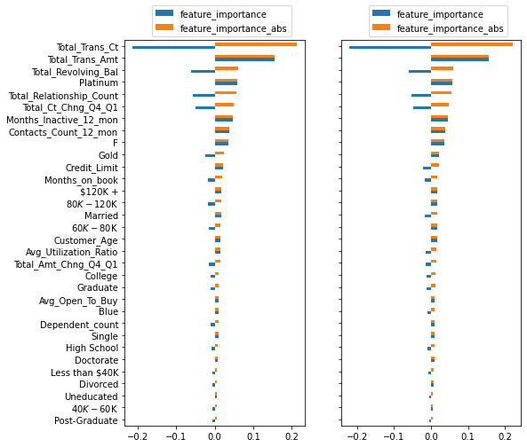
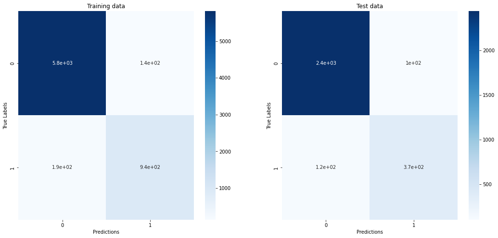

# Credit Card Customer Churn Prediction

Predicting which credit card customers will attrite, and identifying the features
that carry the prediction.

### 📄 [Read the paper — PDF, 26 pages](credit-card-churn-paper.pdf)

Eight model configurations are compared: logistic regression and a neural
network, each with and without Bayesian hyperparameter optimisation, and all four
again after oversampling the minority class with SMOTE-NC. The dataset covers
10,127 customers, of whom 16.1 % have attrited.

## Key findings

**The model family matters more than the tuning.** Moving from logistic
regression to a neural network raised the test F1 score from 0.638 to 0.750. All
subsequent hyperparameter optimisation added 0.024 in total — the gain from
changing the method exceeds the gain from all tuning combined by a factor of
five.

**The explanatory finding is stable.** Across all eight configurations, the same
seven features occupy the top of the importance ranking: transaction count,
transaction amount, revolving balance, number of products held, contact
frequency, number of inactive months, and credit utilisation. Gender, education
level, marital status and income bracket contribute essentially nothing in any
configuration.

**Oversampling shifts the error profile rather than improving the model.** In
every pair, recall increased and precision declined; F1 moved by at most 0.009.
The same intervention also widened the gap between training and test performance
substantially, in one case from 0.015 to 0.191.

## Results

Test-set metrics for all eight configurations:

| Model | Precision | Recall | F1 |
| --- | --- | --- | --- |
| Logistic regression | 0.766 | 0.546 | 0.638 |
| Neural network (20/10) | 0.844 | 0.675 | 0.750 |
| Neural network + Optuna | 0.840 | 0.700 | 0.764 |
| Neural network + Optuna + CV | 0.783 | 0.748 | 0.765 |
| SMOTE-NC + logistic regression | 0.642 | 0.647 | 0.645 |
| SMOTE-NC + neural network | 0.675 | 0.694 | 0.684 |
| SMOTE-NC + Optuna | 0.766 | 0.770 | 0.768 |
| **SMOTE-NC + Optuna + CV** | **0.768** | **0.780** | **0.774** |

## Figures



*Feature importance of the neural network, separately for training and test data.
The ranking is stable across all eight configurations.*



*Confusion matrices of the optimised network with cross-validation.*

The remaining figures are in [`figures/`](figures) — class distribution,
distributions of all features by class, loss curves, and the confusion matrices
and feature importance plots for each of the eight configurations.

## Method

| Step | Approach |
| --- | --- |
| Preprocessing | One-hot encoding of 5 categorical features (18 dummy columns), standardisation fitted on training data only |
| Split | 70/30, single random partition, seed 42, unstratified |
| Baseline | Logistic regression |
| Neural network | 2 hidden layers (20 / 10, tanh), sigmoid output, dropout 0.25, early stopping |
| Tuning | Bayesian optimisation with Optuna, 20 trials, F1 objective; a second variant combined with k-fold cross-validation |
| Oversampling | SMOTE-NC, sampling strategy 0.5 (minority raised to 33.3 %) |
| Metrics | Precision, recall, F1 — reported separately for train and test |
| Feature importance | Sign of the mean gradient times the root mean squared gradient, normalised |

## Dataset

10,127 credit card customers, 19 predictors and one binary target. 16.1 % of
customers have attrited.

Source: [Credit Card customers](https://www.kaggle.com/datasets/sakshigoyal7/credit-card-customers)
on Kaggle. The data originate from the analyttica platform. The dataset is not
included in this repository and remains subject to the terms set by its
publisher.

Two columns were removed before modelling: `CLIENTNUM`, a surrogate identifier,
and two columns containing the output of a pre-computed naive Bayes classifier.
The latter are derived from the target and would have constituted target
leakage.

## Important caveat

The reported metrics are **upper bounds, not measurements**. In the original
pipeline the test partition also served as the validation set — early stopping
monitored its loss and the hyperparameter search evaluated its objective on it.
The model was therefore selected with knowledge of the data on which its
performance is reported, which is the classical form of selection bias
(Cawley & Talbot, 2010).

The comparative ranking between the eight configurations remains informative,
since all of them are affected equally. The absolute values are not. A clean
design would require a third partition held back until the end.

Two further limitations are worth naming: the split is a single unstratified
partition, so no variance estimate is available and the 0.009 F1 advantage of the
best oversampled variant is not statistically established; and the target records
a *state* rather than an *event*, since the data carry no timestamps. The model
separates former customers from current ones — it does not predict who will
leave. Section 8 of the paper treats all of these in detail.

## Contents

```
credit-card-churn/
├── README.md
├── credit-card-churn-paper.pdf
└── figures/                   # 23 figures from the analysis
```

The paper is the full write-up: introduction, related work, data, exploratory
analysis, methodology, results, discussion, limitations, conclusion, and 19
references. The analysis code is not part of this repository.

---

© 2026 Chris. All rights reserved.
